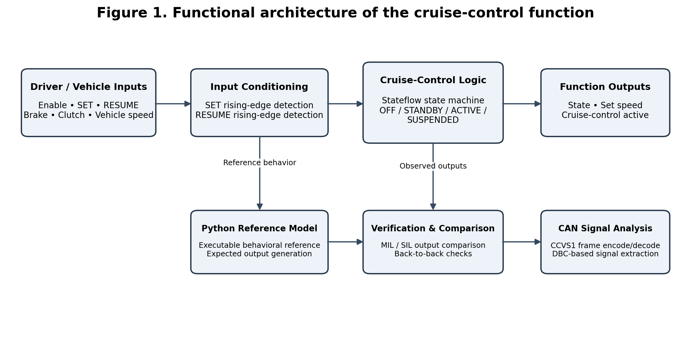
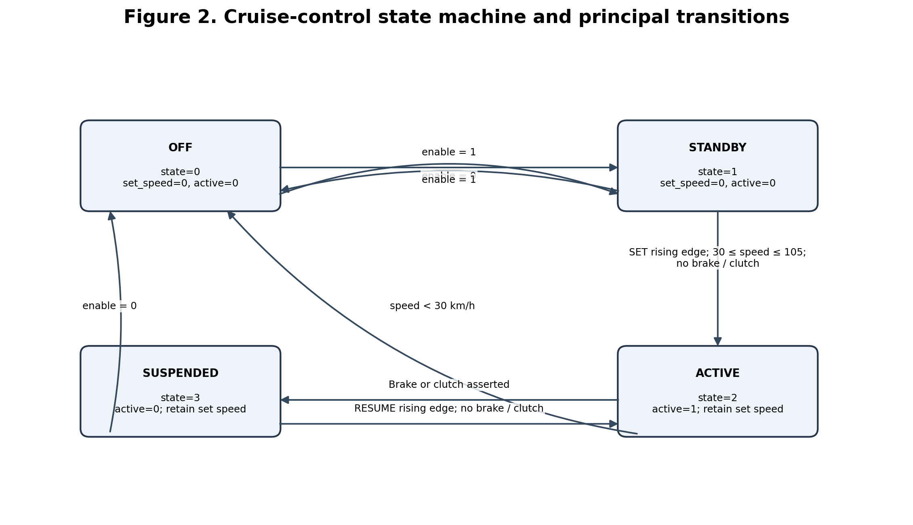
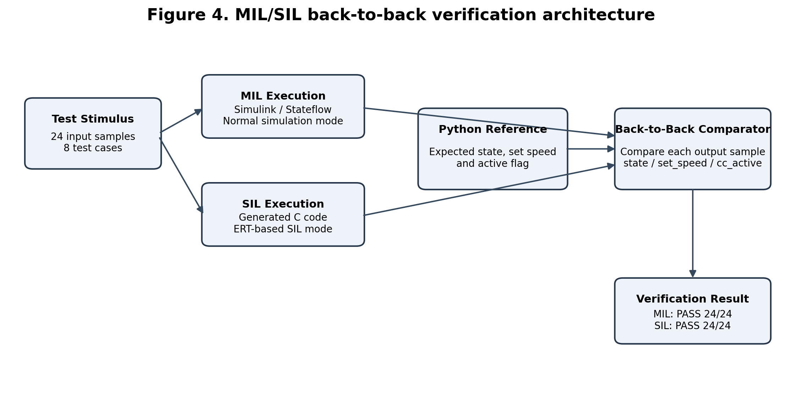

# Model-Based Development and MIL/SIL Verification of an Automotive Cruise Control System

**Simulink and Stateflow implementation with Python-based back-to-back testing and J1939 CCVS1 signal analysis**

This repository contains a model-based automotive cruise-control supervisory function and a supporting verification workflow. The controller is implemented in MATLAB/Simulink and Stateflow, with a Python executable reference model used to generate expected behavior and compare simulation outputs.

> **Project scope:** This is a software/model-based engineering project. It does not demonstrate physical ECU deployment, vehicle road testing, actuator control, or live vehicle CAN-bus capture. The CAN utility generates CCVS1 frames from the Python reference model and decodes them offline using the supplied DBC.

## Project highlights

- Four-state cruise-control supervisory logic: `OFF`, `STANDBY`, `ACTIVE`, `SUSPENDED`.
- Six inputs: enable, SET, RESUME, brake, clutch and vehicle speed.
- Three outputs: state, latched set speed and cruise-control active flag.
- SET and RESUME rising-edge detection using Unit Delay blocks.
- Python reference model and eight requirement-tagged test scenarios.
- Model-in-the-Loop (MIL) and Software-in-the-Loop (SIL) execution.
- Back-to-back comparison of model outputs against reference outputs.
- Requirement-to-test traceability for ten project requirements.
- DBC-based encoding and decoding of selected J1939 CCVS1 signals.

## Recorded verification results

The committed output datasets contain 24 samples. In the recorded verification run:

| Verification | Result |
|---|---:|
| MIL vs Python reference | **PASS — 24/24 samples** |
| SIL vs Python reference | **PASS — 24/24 samples** |
| Requirement traceability | **10/10 requirement IDs PASS** |
| CCVS1 offline decoding | **24 generated frames decoded** |

These results apply to the supplied scenarios and recorded outputs. They are not a claim of complete automotive safety validation or production readiness.

## System architecture

## System architecture



The high-level workflow comprises input conditioning, Stateflow control logic, reference-model generation, MIL/SIL output comparison and offline CAN signal analysis.


## State machine



| State | Code | Behavior |
|---|---:|---|
| OFF | 0 | Cruise control disabled; set speed cleared |
| STANDBY | 1 | Enabled and waiting for a valid SET command |
| ACTIVE | 2 | Cruise-control active indication asserted |
| SUSPENDED | 3 | Brake/clutch override; stored set speed retained |

### Principal transition conditions

- `OFF -> STANDBY`: enable is asserted.
- `STANDBY -> OFF`: enable is removed.
- `STANDBY -> ACTIVE`: SET rising edge, speed from 30 to 105 km/h inclusive, brake and clutch released.
- `ACTIVE -> SUSPENDED`: brake or clutch is asserted.
- `SUSPENDED -> ACTIVE`: RESUME rising edge with brake and clutch released.
- `ACTIVE/SUSPENDED -> STANDBY`: vehicle speed falls below 30 km/h; set speed is cleared.
- Disable returns the controller to `OFF`.

## MIL/SIL verification workflow



The same scenario data is used for the reference and Simulink runs. The comparator checks `state`, `set_speed` and `cc_active` sample by sample.

## Repository structure

```text
.
├── data/
│   ├── ccvs1.log
│   ├── expected_ref.csv
│   ├── j1939_ccvs1.dbc
│   ├── mil_out.csv
│   ├── sil_out.csv
│   └── stimulus.csv
├── docs/
│   ├── Automotive_Cruise_Control_MIL_SIL_Technical_Report.docx
│   ├── build_guide.md
│   ├── traceability.md
│   ├── figures/
│   └── screenshots/
├── model/
│   ├── CruiseCtrl.slx
│   ├── CruiseCtrl_harness.slx
│   └── cruise_ref.py
├── requirements/
│   └── requirements.csv
├── tests/
│   ├── scenarios.py
│   ├── test_j1939.py
│   └── test_reference_model.py
├── tools/
│   ├── b2b_compare.py
│   ├── can_log.py
│   ├── make_stimulus.py
│   ├── run_all.m
│   └── traceability.py
└── README.md
```

## Requirements

### Software

- MATLAB and Simulink.
- Stateflow.
- Simulink Coder / Embedded Coder for the configured generated-code SIL workflow.
- Python 3.10+ recommended.
- Python packages listed in `requirements.txt`.

The original development and recorded ERT-based SIL run used MATLAB R2023b Update 1 on Windows 11. Other MATLAB releases may require model or configuration adjustments.

## Setup

Clone the repository:

```bash
git clone https://github.com/<YOUR-USERNAME>/<YOUR-REPOSITORY>.git
cd <YOUR-REPOSITORY>
```

Create and activate a Python virtual environment:

```bash
python -m venv .venv
```

Windows PowerShell:

```powershell
.venv\Scripts\Activate.ps1
```

macOS/Linux:

```bash
source .venv/bin/activate
```

Install Python dependencies:

```bash
python -m pip install --upgrade pip
pip install -r requirements.txt
```

## Run the Python verification utilities

From the repository root:

```bash
python -m tools.make_stimulus
python -m tools.traceability
python -m pytest -q
python -m tools.can_log
```

Generate the expected stimulus and reference files:

```bash
python -m tools.make_stimulus
```

Generate the requirement traceability matrix:

```bash
python -m tools.traceability
```

Run the offline CCVS1 encode/decode exercise:

```bash
python -m tools.can_log
```

Compare an existing MIL or SIL output CSV with the expected reference:

```bash
python tools/b2b_compare.py data/mil_out.csv
python tools/b2b_compare.py data/sil_out.csv
```

## Run MIL and SIL in MATLAB

1. Open MATLAB and set the current folder to the repository root.
2. Ensure the model and tools directories are on the MATLAB path as required by the project.
3. Open `model/CruiseCtrl_harness.slx`.
4. Confirm that the model reference block points to `CruiseCtrl`.
5. Run MIL:

```matlab
run_all('Normal','data/mil_out.csv')
```

6. Compare the MIL result:

```bash
python tools/b2b_compare.py data/mil_out.csv
```

7. Configure the referenced model for the project's ERT-based SIL workflow and run:

```matlab
run_all('Software-in-the-Loop (SIL)','data/sil_out.csv')
```

8. Compare the SIL result:

```bash
python tools/b2b_compare.py data/sil_out.csv
```

The `tools/run_all.m` script is the project-specific automation entry point. Refer to [`docs/build_guide.md`](docs/build_guide.md) for model setup notes.

## Requirements and traceability

The ten functional requirements are defined in [`requirements/requirements.csv`](requirements/requirements.csv). The recorded mapping and reference-run status are in [`docs/traceability.md`](docs/traceability.md).

## CAN / J1939 analysis

The DBC file describes a selected subset of signals associated with a CCVS1 message. `tools/can_log.py` creates software-generated frames from the reference-model scenarios, writes a candump-style log and decodes the values using `cantools`.

This is an offline software exercise. It does not verify physical CAN transceiver behavior, bus timing, network loading, a live ECU or full J1939 conformance.

## Technical report

The detailed editable report is available at:

[`docs/Automotive_Cruise_Control_MIL_SIL_Technical_Report.docx`](docs/Automotive_Cruise_Control_MIL_SIL_Technical_Report.docx)

It includes the system design, state machine, implementation, verification results, diagrams, plots, traceability and project limitations.

## Limitations

- The implemented function is a supervisory state machine, not a complete closed-loop cruise-control system.
- No throttle/torque actuation or vehicle plant model is included.
- No physical ECU, HIL bench or road testing is included in the evidence.
- SIL results are host-based generated-code verification, not target-processor timing evidence.
- Eight test cases and 24 samples provide a focused demonstration, not exhaustive verification.
- The CAN frames are generated and decoded offline; no live bus capture is claimed.
- The supplied DBC is a project-specific signal subset, not a complete conformance-certified J1939 database.

## Suggested next extensions

- Add a longitudinal vehicle plant and closed-loop speed controller.
- Add boundary-value and fault-injection tests.
- Add model coverage and transition coverage analysis.
- Add Processor-in-the-Loop (PIL) or Hardware-in-the-Loop (HIL) testing.
- Add diagnostics, sensor plausibility checks and safe-state handling.
- Integrate Python, MIL and SIL checks into a CI pipeline.

## License

No open-source license is currently assigned. Unless a license is added, the repository remains under the copyright holder's default rights. Add a license only after deciding how you want others to use, modify and redistribute the work.

## Disclaimer

This repository is an educational/personal engineering demonstration. It is not intended for direct deployment in a production vehicle or safety-critical system.
